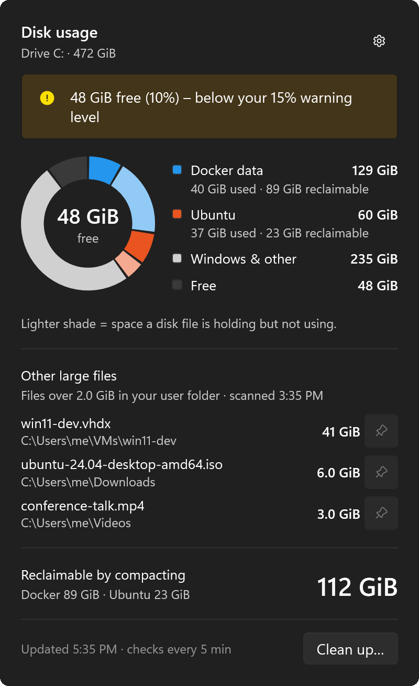
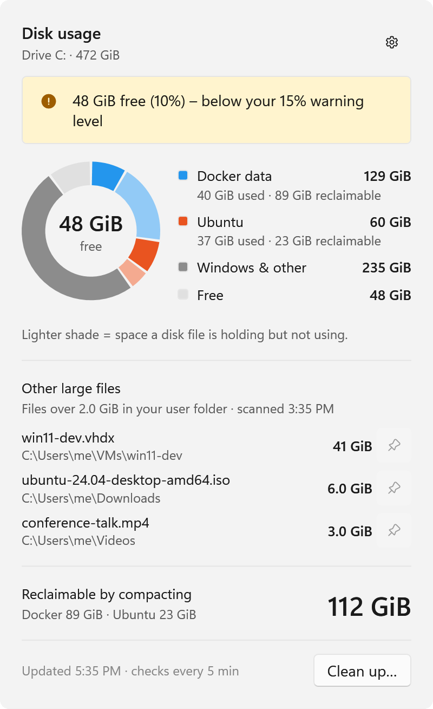
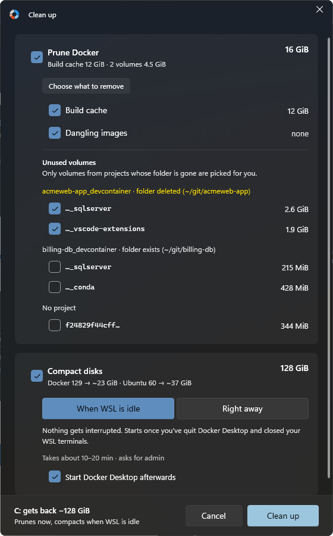
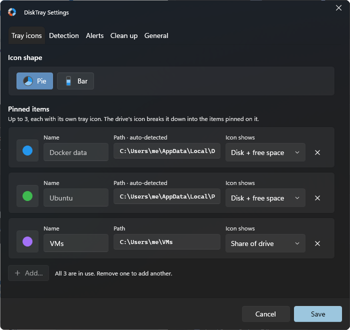

# DiskTray

A Windows tray app that shows how much of your Windows drive (usually C:) your WSL and
Docker virtual disks take up, warns when space runs low, and helps reclaim it (prune
Docker, compact the VHDX files).

<p align="center">
  
  
</p>

Each tray icon is a pie (or bar) of one disk file or drive. The lighter shade is space
the file holds but isn't using, which compacting gives back. An amber or red ring means
the drive is below your warning level:

<p align="center">
  <picture>
    <source media="(prefers-color-scheme: light)" srcset="docs/images/tray-light.png">
    
  </picture>
</p>

**Clean up** prunes Docker and compacts the disks. Unused volumes are grouped by the
project they came from, and only those whose project folder is gone are picked for you.
By default it waits until you've quit Docker Desktop and closed WSL, so nothing gets
interrupted.

<p align="center">
  
</p>

In **Settings** you choose up to three things to pin to the tray (Docker's disk, a
distro, a drive, or any file or folder) and their colors, what's detected, alert
levels and what Clean up starts with.

<p align="center">
  
</p>

See [docs/design.md](docs/design.md) for the design.

## Install

Download the MSI from [Releases](../../releases) and run it. It installs to
`C:\Program Files\DiskTray` and asks for admin once, so that the part of Clean up that
runs as admin can't be changed by other programs. It isn't signed, so Windows shows
"Windows protected your PC" the first time; choose **More info**, then **Run anyway**.
Each release has a `SHA256SUMS.txt` to check the download against
(`Get-FileHash DiskTray-<version>-x64.msi`).

Uninstall it from **Settings › Apps**. That also removes your DiskTray settings, logs and
caches (`%LOCALAPPDATA%\DiskTray`) and its Startup apps entry. Docker and WSL aren't
touched.

Clean up needs Docker Desktop 4.39 or later, using the WSL 2 backend, to prune and to
stop and start Docker around a compact.

New tray icons start out in the taskbar's overflow (`^`). To keep them visible, turn
them on under **Settings → Personalization → Taskbar → Other system tray icons**, or
drag them onto the taskbar.

## Layout

| Project | What it is |
|---|---|
| `src/DiskTray.Core` | UI-free logic (`net10.0`) |
| `src/DiskTray.App` | WPF tray app (`net10.0-windows`) |
| `src/DiskTray.Compactor` | Elevated helper that compacts VHDX files |
| `tests/DiskTray.Core.Tests` | Unit tests for Core (run anywhere, including WSL) |
| `installer` | WiX project for the MSI |
| `scripts/deploy.sh` | Publishes a development copy from WSL to Windows and restarts it |
| `scripts/build-msi.sh` | Builds the MSI from WSL |

## Build

Needs the .NET 10 SDK. Builds from Windows or WSL, but runs only on Windows. The
development copy needs the .NET 10 Desktop Runtime; the installer brings its own.

```sh
dotnet build DiskTray.slnx
dotnet test
```

## Building the installer

Releases are built by GitHub Actions, on pushes to main, pull requests and tags, and
attached to a release for each `v<version>` tag. The Compactor, the part that runs as
admin, is compiled ahead of time with NativeAOT, which needs Windows and the C++ build
tools.

`scripts/build-msi.sh` builds `artifacts/msi/DiskTray-<version>-x64-dev.msi` from WSL,
for trying the installer out, with a plain .NET Compactor (it also needs a .NET 6 or
later SDK on Windows, since WiX only runs there).

## Development copy

`scripts/deploy.sh` publishes a development copy to `%LOCALAPPDATA%\Programs\DiskTray`
and starts it, closing a running copy first. That copy can't compact disks: the
Compactor only runs as admin from a folder that needs admin to change.
`scripts/uninstall.sh` removes it.

Errors are logged to `%LOCALAPPDATA%\DiskTray\logs\disktray.log`.

## License

[MIT](LICENSE)
